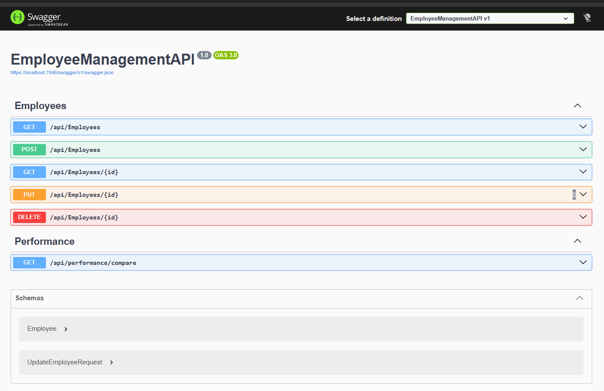
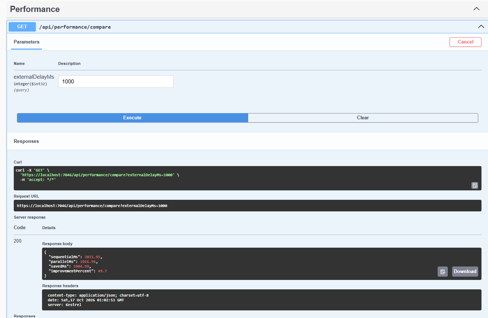

# Employee Management API: Async/Await & Performance (Task 5 Huma Volve)

A practice project for the Day 5 task of the work simulation: an ASP.NET Core Web API
(.NET 10) with EF Core and SQL Server, built with async/await.

## Features
- Async CRUD for employees: Create, Get, GetAll, Update, Delete
- Service layer; controllers only handle the request and response
- Global exception handler (returns 404 when an employee does not exist)
- `CancellationToken` passed from the controller to the service to EF Core
- Serilog console logging (configured in appsettings, includes HTTP request logs)
- Performance comparison endpoint: `GET /api/performance/compare`

## How to run
1. Update the connection string in `appsettings.json` if needed (LocalDB by default)
2. Run `Update-Database` in the Package Manager Console
3. Run the project and open the OpenAPI/Swagger page

## Performance report

### Goal
Compare two independent operations executed **sequentially** and **in parallel**
(`Task.WhenAll`), measured with `Stopwatch`.

### Setup
- Operation A: a database query for all employees (with its own `DbContext`
  from `IDbContextFactory`, because a `DbContext` cannot run concurrent operations)
- Operation B: a simulated external service call (`Task.Delay`)
- A warm-up run happens before measuring so the first-query cost does not distort the result
- Endpoint: `GET /api/performance/compare?externalDelayMs=...`

### Test 1: operation A is fast (about 3 ms), operation B is slow

| B delay | Sequential (ms) | Parallel (ms) | Saved (ms) |
|---|---|---|---|
| 1000 | 1003.26 | 1016.31 | -13.05 |
| 200 | 204.35 | 217.22 | -12.88 |
| 0 | 1.04 | 1.36 | -0.32 |
| 5 | 8.63 | 15.87 | -7.24 |

### Test 2: both operations take about the same time
(Operation A's slowness was simulated with `Task.Delay` inside the method.)

| Delay of each | Sequential (ms) | Parallel (ms) | Saved (ms) | Improvement |
|---|---|---|---|---|
| 1000 | 2004.51 | 1015.02 | 989.49 | 49.4% |
| 200 | 425.64 | 205.94 | 219.69 | 51.6% |
| 0 | 1.22 | 1.68 | -0.46 | not meaningful |

### Findings
- Sequential time is about **A + B**. Parallel time is about **max(A, B)**.
- Parallel saves at most the duration of the **shorter** operation.
- When one operation was tiny (Test 1), parallel gave no benefit. It was even a few
  milliseconds slower, because starting two tasks has overhead and timer precision
  is limited. These differences are within measurement noise.
- When both operations took a similar time (Test 2), parallel cut the total time
  by about half.
- With very small times (0 ms delay), percentages are meaningless, since the
  differences are fractions of a millisecond.

### Conclusion
Parallel execution **did improve performance, but only when both independent operations
had a meaningful and similar duration**. For a very short operation next to a long one,
or for tiny operations, it adds complexity (and extra database connections)
without a real gain.

### Lessons learned
- `async/await` frees threads during I/O waits. It does not make a single operation faster.
- `Task.WhenAll` is only for independent operations.
- Parallel EF Core queries need separate `DbContext` instances (`IDbContextFactory`).
- Pass the `CancellationToken` all the way down to the I/O call.
